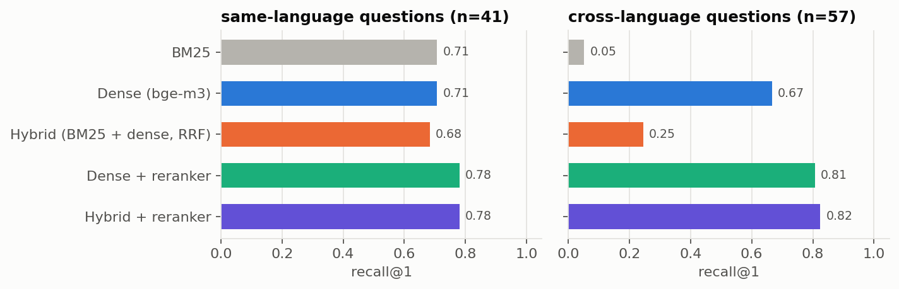
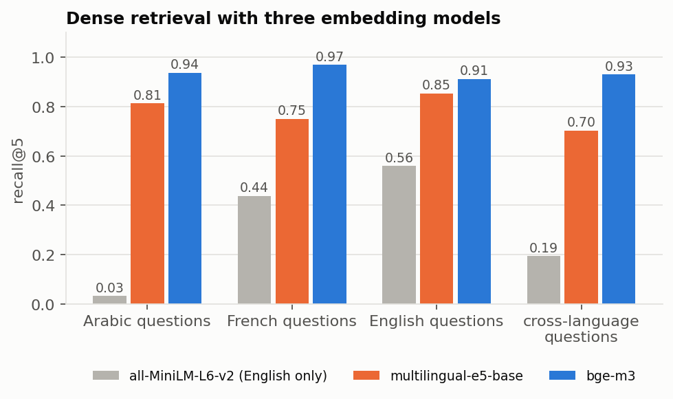
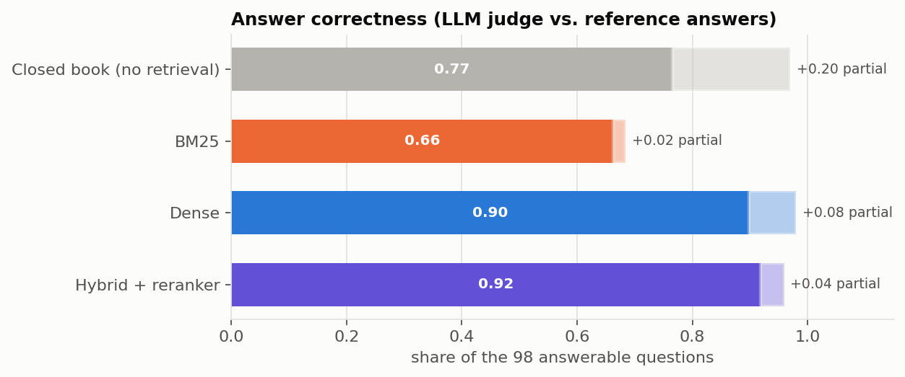
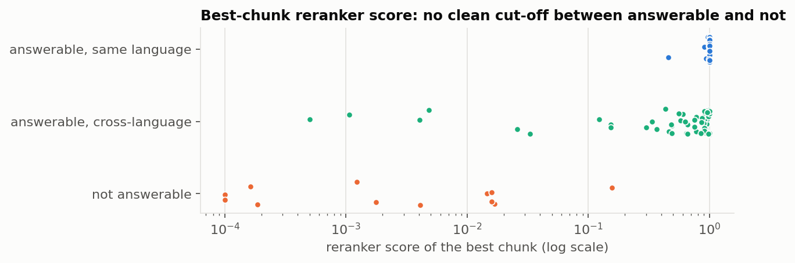
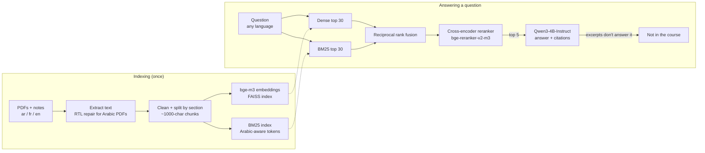
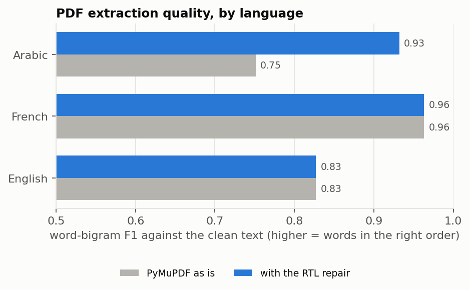

# Multilingual RAG assistant for university course documents

A question-answering assistant over course PDFs and lecture notes in **Arabic, French and English**. Ask in any of the three languages; it finds the relevant passages in whichever language they're written in, answers in your language, and cites the exact passage (and PDF page) behind every sentence. If the course doesn't cover the question, it says so instead of making something up.

Built with LangChain, FAISS, bge-m3 embeddings, a cross-encoder reranker, Qwen3-4B running locally, and FastAPI.

## Results

Evaluated on 110 questions written in all three languages: 98 answerable from the course documents (57 of them **cross-language**: asked in one language, answered only in another) and 12 that the course doesn't cover. Details on the evaluation set are [below](#the-evaluation-set).

**Retrieval:** is the right passage in what the LLM gets to read?

| Strategy | Recall@1 | Recall@5 | MRR@10 | Recall@1, same language | Recall@1, cross-language | Latency |
|---|---|---|---|---|---|---|
| BM25 | 0.33 | 0.54 | 0.42 | 0.71 | 0.05 | 1 ms |
| Dense (bge-m3 + FAISS) | 0.68 | 0.94 | 0.80 | 0.71 | 0.67 | 18 ms |
| Hybrid (BM25 + dense, RRF) | 0.43 | 0.79 | 0.60 | 0.68 | **0.25** | 19 ms |
| Dense + reranker | 0.80 | 0.96 | 0.87 | 0.78 | 0.81 | 136 ms |
| **Hybrid + reranker** (served) | **0.81** | **0.97** | **0.88** | **0.78** | **0.82** | 133 ms |

**Answers:** Qwen3-4B given the top 5 chunks (or nothing, for the closed-book baseline).

| Setup | Correct | Refused the 12 out-of-course questions | Wrongly said "not found" | Faithfulness (LLM judge / NLI) | Citation precision |
|---|---|---|---|---|---|
| Closed book, no retrieval | 0.77 | **0 of 12** | 2% | – | – |
| BM25 | 0.66 | 10 of 12 | 30% | 0.91 / 0.83 | 0.94 |
| Dense | 0.90 | 12 of 12 | 2% | 0.94 / 0.89 | 0.93 |
| **Hybrid + reranker** (served) | **0.92** | **12 of 12** | 3% | **0.96** / 0.85 | **0.95** |

_Correct = matches the reference answer, judged by an LLM. Faithfulness = share of answer sentences supported by the retrieved passages, measured by two different judges (see below). Citation precision = share of cited sentences that the cited passage actually supports._

<p align="center"></p>

## What I learned

**1. The reranker does the heavy lifting. Hybrid search on its own made things worse.** BM25 + vector search with reciprocal rank fusion is the standard recommendation, so I expected it to help. On same-language questions it's neutral. On cross-language questions it's harmful: a French question shares no words with the Arabic passage that answers it, so BM25 returns confidently wrong French passages, and fusion gives them as much weight as the dense results. Cross-language recall@1 falls from 0.67 to 0.25. The cross-encoder reranker reads question and passage together and fixes this: +0.09 MRR over plain dense search (paired bootstrap 95% CI: +0.03 to +0.15). Hybrid + reranker vs dense + reranker is close to a tie (+0.012 MRR, CI from 0.000 to +0.034). I kept BM25 in the served pipeline because it costs 1 ms and catches exact identifiers (`sem_post`, `RFC 793`), but the measured gain comes from the reranker. ([notebook 02](notebooks/02_retrieval_evaluation.ipynb))

**2. "Multilingual" in the embedding model's name isn't enough.** An English-only model finds the right passage for 3% of Arabic questions. `multilingual-e5-base` is good within a language but drops to 0.70 recall@5 across languages; `bge-m3` stays at 0.93.

<p align="center"></p>

**3. When retrieval is right, the answer is right.** With a relevant passage in the top 5, answers are correct 95–100% of the time for every retriever. When hybrid + reranker misses (3 questions, all cross-language into the small Arabic corpus), the model says "not found" instead of guessing. Retrieval is the bottleneck, not the LLM.

**4. The no-retrieval baseline is strong, and that's an honest limitation of using Wikipedia.** Qwen has seen these articles in pretraining, so closed-book it gets 77% fully right. With a real lecturer's notes the gap would be larger. Retrieval still adds 15 points, mostly by turning half-right answers into complete ones. The bigger difference is behaviour: closed-book, the model confidently answered **all 12** questions the course doesn't cover ("Which port does HTTPS use?" → "443"), with nothing to cite. With retrieval it refused all 12.

<p align="center"></p>

**5. Measuring faithfulness across languages is its own problem.** I scored every answer sentence with two judges: a multilingual NLI model (mDeBERTa), which is independent but turned out to under-score cross-language paraphrases ("first described in 1971" vs the French passage saying the same thing scores 0.01 entailment), and the LLM itself, which handles languages but is grading its own writing. They agree on 84% of sentences, and nearly every disagreement is NLI saying "unsupported" where the LLM says "supported". So I report both, as a range (0.85–0.96), not one number. When *both* judges reject a sentence, it's usually an embellishment ("…to avoid data loss") rather than an invented fact. ([notebook 03](notebooks/03_generation_and_faithfulness.ipynb))

**6. An idea that didn't work.** I planned to skip the LLM when the reranker's best score was low, as a cheap "not in the course" filter. But the reranker scores cross-language pairs low even when they're right: one correctly answered Arabic→French question scored 0.0005, below most off-topic questions. Every threshold refused good answers and caught nothing the LLM didn't already refuse, so it's off by default.

<p align="center"></p>

---

## Why this project

In Algerian universities, as in many places, one degree mixes languages: one module is taught in French, the next has English slides, some material is in Arabic. A student who thinks in one language often needs an answer that is written down in another. Keyword search (and plain Ctrl+F) fails exactly there: a French question about *descente de gradient* shares no words with the English notes on *gradient descent*.

I wanted to know what it takes for retrieval-augmented generation to work across those languages, and to **measure** each design decision instead of copying the standard recipe. One of those measurements contradicted the standard recipe (see [Results](#results)).

## How it works



**1. Getting clean text out of the documents** ([`pdf.py`](src/course_rag/pdf.py), [`ingest.py`](src/course_rag/ingest.py), [notebook 01](notebooks/01_corpus_and_pdf_extraction.ipynb)). Arabic PDFs are the hard part. PyMuPDF returns Arabic lines that mix in Latin words with their phrases in the wrong order, so the words are right but the sentence is scrambled. I fixed it at character level: sort each line's characters right to left using their x positions, then flip the embedded Latin runs back. Measured against Wikipedia's clean text of the same articles, word-order quality (word-bigram F1) for Arabic goes from **0.75 to 0.93**, and French and English are unchanged. The markdown notes had a different problem: every formula came out as dozens of one-character lines, which I collapse back into inline LaTeX.

<p align="center"></p>

**2. Chunking.** Sections are cut into ~1,000-character chunks (150 overlap) and never across a section boundary. Each chunk starts with `Document title > Section > Subsection`, which gives both the retriever and the LLM context. PDF chunks keep their page number for citations.

**3. Retrieval** ([`retrievers.py`](src/course_rag/retrievers.py)). Four strategies, all as LangChain retrievers:
- **BM25** with Arabic-aware tokenization: short vowels removed, alef/yā/tā marbūṭa variants folded together, the article ال and attached و/ب/ك/ل stripped, so `والشبكة` matches `الشبكه`.
- **Dense**: bge-m3 embeddings (100+ languages, one shared vector space) in a FAISS inner-product index.
- **Hybrid**: reciprocal rank fusion of the two lists (rank-based, so the very different score scales don't matter).
- **Reranking**: `bge-reranker-v2-m3`, a multilingual cross-encoder that reads question and passage *together*, re-scores the 30 best candidates.

**4. Answering** ([`generator.py`](src/course_rag/generator.py), [`pipeline.py`](src/course_rag/pipeline.py)). The top 5 chunks go to **Qwen3-4B-Instruct-2507**, running locally in bf16 on a 12 GB RTX 5070, as numbered excerpts. The prompt requires a `[n]` citation after every sentence, an answer in the question's language, and one fixed "not found" sentence when the excerpts don't answer the question. Citations are parsed and mapped back to document, section, page and URL. A score threshold that skips the LLM when retrieval looks weak exists too, but it's off by default ([finding 6](#what-i-learned)).

**5. Serving** ([`api.py`](src/course_rag/api.py)). FastAPI with `/ask`, `/search` (retrieval only), `/documents` and `/health`.

## Using the API

```bash
uvicorn course_rag.api:app --app-dir src --port 8000
# interactive docs: http://localhost:8000/docs
```

```bash
curl -s localhost:8000/ask -H "Content-Type: application/json" \
     -d '{"question": "À quoi sert le champ « taille de la fenêtre » dans l'\''en-tête TCP ?"}'
```

A French question whose answer exists only in the Arabic networking course (shortened):

```json
{
  "question": "À quoi sert le champ « taille de la fenêtre » dans l'en-tête TCP ?",
  "language": "fr",
  "answer": "Le champ « taille de la fenêtre » indique le nombre d'octets que le destinataire peut recevoir sans avoir à demander de confirmation, ce qui permet de gérer le débit et éviter les pertes de données [1]. Il détermine la taille de la fenêtre glissante utilisée par l'expéditeur [1].",
  "abstained": false,
  "citations": [
    {
      "n": 1,
      "chunk_id": "ar/tcp#003",
      "title": "بروتوكول التحكم بالإرسال",
      "section": "الوظيفة الشبكية",
      "page": 2,
      "lang": "ar",
      "url": "https://ar.wikipedia.org/wiki/بروتوكول_التحكم_بالإرسال",
      "snippet": "5- حجم النافذة: وهو رقم يخبر به مرسل هذا الطرد الطرف الآخر بعدد الثمانيات التي يمكن لمرسل هذا الطرد أن يستقبلها …",
      "score": 0.461
    }
  ],
  "sources": ["… all 5 passages the model was given …"],
  "timings_ms": {"retrieval": 242, "generation": 6304}
}
```

The core of the answer (the receiver tells the sender how many bytes it can accept; the field sets the sliding window) is right, and it's cited to the exact passage and PDF page. The tail of the first sentence ("without asking for confirmation… avoid data loss") isn't in the source, though. That's the kind of embellishment the faithfulness judges flag, and I left the example as is rather than pick a perfect one.

Ask "Which port does HTTPS use by default?" and you get `"I could not find this in the course documents."` with `"abstained": true`.

Options: `mode` (`bm25`, `dense`, `hybrid`, `dense_rerank`, `hybrid_rerank`; default `hybrid_rerank`) and `k` (number of chunks, default 5). Set `COURSE_RAG_NO_LLM=1` to run retrieval only (`/search`), which works without a GPU.

From the terminal: `python -X utf8 scripts/ask.py "ما هو نظام أسماء النطاقات؟"`, or with no argument for an interactive prompt.

## The evaluation set

[`data/eval/questions.csv`](data/eval/questions.csv): **110 questions**, written by hand in all three languages.

- **98 answerable**, each labelled with the document and a short **evidence quote** containing the answer, plus a reference answer.
- **57 of them are cross-language** (asked in one language, answered only in another); all 9 language pairs are covered.
- **12 are not answerable** from the course: near-misses like the HTTPS port or two-phase commit, plus a few off-topic ones.

Labels are evidence quotes, not chunk ids. A chunk counts as relevant if it contains at least half of the quote after normalisation. That keeps the labels valid when the chunking changes, which is what makes the chunk-size comparison fair. `scripts/check_eval_set.py` verifies that every quote really exists in its document and writes [`data/eval/review.md`](data/eval/review.md), a sheet with each question next to its source passage for manual checking.

**How the labels were made, honestly:** I drafted the questions, reference answers and evidence quotes with the help of an AI assistant, reading from the corpus. A script checks that every evidence quote exists word for word in its document. The labels were then reviewed with AI assistance: 102 of 110 are marked `verified` in the CSV, and the other 8 carry a note. The labels come from a single source, not several independent annotators, so treat small differences between systems (like dense vs hybrid + reranker) as noise.

## Run it yourself

Tested on Windows 11, Python 3.13, RTX 5070 (12 GB). Retrieval alone runs fine on a CPU; generation needs a GPU with about 10 GB free.

```bash
git clone https://github.com/sadjedb/multilingual-course-rag.git
cd multilingual-course-rag
pip install torch --index-url https://download.pytorch.org/whl/cu128   # match your CUDA version
pip install -r requirements.txt

python -X utf8 scripts/build_index.py                  # chunks + bge-m3 FAISS index, ~1 min with model download
python -X utf8 scripts/ask.py "Qu'est-ce qu'un sémaphore ?"
```

The documents are already in `data/raw/`. `scripts/fetch_corpus.py` downloads them again from Wikipedia. (`-X utf8` only matters on Windows, where the console is not UTF-8 by default.)

To reproduce the evaluation:

```bash
python -X utf8 scripts/build_index.py --all-models --chunk-sizes 500 1500   # comparison indexes
python -X utf8 scripts/check_eval_set.py          # validate labels, write the review sheet
python -X utf8 scripts/evaluate_retrieval.py      # ~3 min
python -X utf8 scripts/evaluate_generation.py     # ~75 min, resumable
pytest -q                                         # 22 tests
```

Then run the notebooks in order:

| Notebook | What it covers |
|---|---|
| [01 · Corpus and PDF extraction](notebooks/01_corpus_and_pdf_extraction.ipynb) | the corpus, the Arabic PDF problem and its fix, measured; formula cleanup; chunk statistics |
| [02 · Retrieval evaluation](notebooks/02_retrieval_evaluation.ipynb) | the five strategies, same- vs cross-language, why hybrid hurts, embedding models, chunk sizes, remaining misses |
| [03 · Generation and faithfulness](notebooks/03_generation_and_faithfulness.ipynb) | correctness, faithfulness with two judges, citations, abstention threshold, examples and failures |

**To use your own course files**, put them in `data/raw/<lang>/`, add rows to `data/raw/manifest.csv` (PDF or markdown), and rebuild the index. `data/private/` is git-ignored for material you can't publish.

## Project layout

```
src/course_rag/
  config.py        paths, model names, defaults
  text.py          Arabic normalisation, language detection, BM25 tokens
  pdf.py           PDF extraction with the right-to-left repair
  ingest.py        loading, cleaning, section-aware chunking
  retrievers.py    BM25 / dense / hybrid (RRF) / rerank as LangChain retrievers
  index.py         embeddings, FAISS, one SearchIndex object for all strategies
  generator.py     Qwen prompt, citations, abstention
  pipeline.py      question -> answer with sources
  evaluation.py    relevance from evidence quotes, recall@k / MRR, NLI and LLM judges
  api.py           FastAPI app
scripts/           fetch_corpus, build_index, check_eval_set, evaluate_retrieval, evaluate_generation, ask
notebooks/         01-03, executed, with outputs
data/              raw documents, processed chunks, the evaluation set, attribution
results/           metrics (json/csv), per-answer scores, figures
tests/             unit tests + API smoke test
```

## Limitations

- **The corpus is Wikipedia**, chosen so anyone can rebuild it. The model has seen it in pretraining, which flatters the closed-book baseline. Arabic is only 13% of the chunks, which is realistic but makes Arabic answers the most fragile.
- **The evaluation set is small and single-source** (see above): 98 answerable questions can separate big effects, not small ones.
- **Neither judge is calibrated against human labels.** The LLM judge is the same model that wrote the answers; the NLI judge under-scores cross-language claims.
- **Text extraction isn't perfect.** Some Arabic PDF words keep a stray space (`م ضيفين`), and in a few English PDFs the bibliography wasn't detected as a section, so some DOI lines ended up in chunks (no question depends on them). Scanned PDFs (no text layer, common for real lecture handouts) would need OCR, which isn't implemented.
- **Speed.** About 1 s for a "not found" answer and 5–6 s for a full one, with plain `transformers` on Windows. A serving engine (vLLM, llama.cpp) would be much faster. On a 12 GB card the query embedder runs on the CPU so that Qwen and the reranker fit on the GPU (`COURSE_RAG_EMBEDDER_DEVICE`).
- **Single-turn.** No conversation memory; language detection is a heuristic and can misjudge very short or mixed-language questions.

**What I'd try next:** translate each question into the other two languages and retrieve with all three (to fix the remaining cross-language misses); hand-label ~50 answers to calibrate both judges; OCR for scanned PDFs; streaming answers.

## Credits and licenses

- Code: MIT ([LICENSE](LICENSE)).
- Documents: Wikipedia articles, CC BY-SA 4.0. Every file, URL and revision is listed in [data/ATTRIBUTION.md](data/ATTRIBUTION.md).
- Models: [bge-m3](https://huggingface.co/BAAI/bge-m3) (BAAI, MIT) and [bge-reranker-v2-m3](https://huggingface.co/BAAI/bge-reranker-v2-m3) (BAAI, Apache 2.0); [Qwen3-4B-Instruct-2507](https://huggingface.co/Qwen/Qwen3-4B-Instruct-2507) (Qwen team, Apache 2.0); [mDeBERTa-v3 multilingual NLI](https://huggingface.co/MoritzLaurer/mDeBERTa-v3-base-xnli-multilingual-nli-2mil7) (Moritz Laurer, MIT); [multilingual-e5-base](https://huggingface.co/intfloat/multilingual-e5-base) (MIT) and [all-MiniLM-L6-v2](https://huggingface.co/sentence-transformers/all-MiniLM-L6-v2) (Apache 2.0) for comparison.

---

_by Sadjed Bougandoura_
